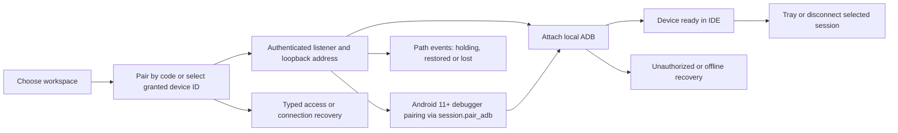

# Desktop screen inventory

**Selected layout** · Relay sidebar and workspace cards with the Signal status strip. The strip presents listener, local ADB, and transport as independent facts. [Canonical journeys and acceptance tests](JOURNEYS.md) · [TDD tickets](TDD_TICKETS.md) · Baseline: **Setu-SDK v1.1.0** · [921aded](https://github.com/SumukhaK/Setu/commit/921aded)

```text
Setu                          Prototype scenarios
┌────────────────────┬──────────────────────────────────────────┐
│ Workspace switcher │ Workspace                    Add device │
│ Workspace          ├──────────────┬───────────┬───────────────┤
│ Devices            │ Listener     │ Local ADB │ Transport     │
│ Audit log          ├──────────────┴───────────┴───────────────┤
│ Diagnostics        │ Selected device ID                       │
│ Settings           │ ADB endpoint and recovery                │
│                    │ Connect ADB · Move to tray · Disconnect  │
│                    ├──────────────────────────────────────────┤
│                    │ Saved devices or organization directory │
└────────────────────┴──────────────────────────────────────────┘
```

| ID | Screen or state | Data and primary action | Acceptance |
| --- | --- | --- | --- |
| D01 | Workspace selector | Solo opens local state immediately. Corporate opens configuration status and the app-level SSO entry. Each workspace has its own daemon and state directory (`daemon_ready` on start). Managed guidance explains that the host and relay enforce policy. | P01, P07, P12, P18 |
| D02 | Pair new device sheet | Numeric 4+6 code, formatted as typed or pasted. Submit to `session.connect`, with inline malformed, rejected (`-32013`) and unavailable (`-32011`) outcomes. **Cancel** calls `session.cancel {request_id}`. | P02, P03, P19 |
| D03 | Device list and device detail | Solo: `devices.list` for local pins, presence unknown. Corporate: `devices.presence` for granted devices with presence from a successful snapshot less than 60s old, else **Last seen unknown**. Show exact ID and editable local nickname. Connect or forget locally. | P08, P11, P17, P21 |
| D04 | Current session and status strip | Separate authenticating, tunnel/listener ready and ADB attachment. Copy the loopback address or connect local ADB. Show unauthorized/offline recovery. Path from `path_up`/`path_down` `transport`, else audit `session_start`, else **Path unknown**. | P09 |
| D05 | Android system pairing handoff | Six-digit system code and optional pairing port from Android's dialog, sent with `session.pair_adb`. Explain separate Setu and Android trust steps. Show **Leave empty to let the phone find it**. Recover from `-32023` with a fresh system code. For `-32024` show **Update Setu on the phone to use this**. Behind a flag until the device-lab run passes. | P05, P20 |
| D06 | Corporate recovery panel | Map only typed codes (`-32014` to `-32018`, `-32024`, `-32025`, `-32026`) to the corresponding help. Device policy and grant failures point to the administrator. Invalid and expired credentials point to SSO; tokens rotate through the identity file or `auth.set_token` without a restart. | P11, P12, P13 |
| D07 | Background and recovery | A tray restore preserves the session. Holding and lost banners come from `path_down`, `path_up` and `path_lost`, keyed by tunnel id. `-32025` and `-32026` show end states with a manual **Reconnect**. T−5 minute warning requires a matching authoritative session deadline. | P13, P14, P17, P21 |
| D08 | This Computer's Audit Log | Lead with anchor status, then coverage, verifier details and JSON, CSV, or HTML export. The organization collector is external to this screen. | P15 |
| D09 | Diagnostics | Run `doctor` and render returned checks, status, detail and fix hints. | P16 |
| D10 | Settings | Set computer name (`--label`), relay URL, leaf DER certificate pin, and HTTP CONNECT proxy. Applying restarts that workspace's daemon after confirming the live sessions it will end. Provide local trust and workspace context. | P16, P17, P22 |

### Prototype RPC boundary

A native test host can provide `window.setuDesktopRpc(method, params, requestId?)` before load. Return decoded daemon results or reject with a numeric RPC `code`. Use the supplied ID on the same IPC connection for `session.cancel`. Forward daemon notifications to `window.setuDesktopEvent(notification)`.

The optional `window.setuDesktopRequestToken(identity)` performs organization SSO. The returned JWT goes through `auth.set_token`; native refresh may also call `window.setuDesktopSetToken(token)`. `window.setuDesktopStartupArguments()` supplies Computer name as separate `--label` arguments. Supply ADB observations through `window.setuDesktopAdbStatus({adb_addr,status})`. `window.setuDesktopSessionDeadline({session_id,expires_at})` accepts only authoritative session deadlines. Standalone operation uses labeled fixtures.


