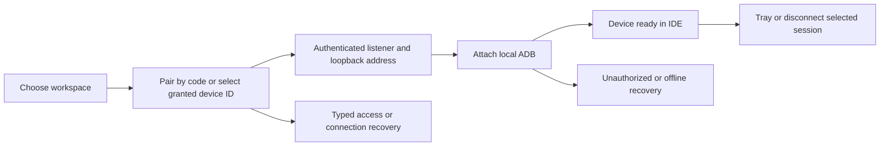

# Desktop screen inventory

**Selected layout** · Relay sidebar and workspace cards with the Signal status strip. The strip presents listener, local ADB, and transport as independent facts. [Canonical journeys and acceptance tests](JOURNEYS.md)

```text
Setu                          Prototype scenarios
┌────────────────────┬──────────────────────────────────────────┐
│ Workspace switcher │ Workspace                    Add device │
│ Workspace          ├──────────────┬───────────┬───────────────┤
│ Devices            │ Listener     │ Local ADB │ Transport     │
│ Audit log          ├──────────────┴───────────┴───────────────┤
│ Diagnostics        │ Selected device ID                       │
│ Settings           │ ADB endpoint and recovery                │
│                    │ Connect ADB · Move to tray · Disconnect  │
│                    ├──────────────────────────────────────────┤
│                    │ Saved devices or organization directory │
└────────────────────┴──────────────────────────────────────────┘
```

| ID | Screen or state | Data and primary action | Acceptance |
| --- | --- | --- | --- |
| D01 | Workspace selector | Solo opens local state immediately. Corporate opens configuration status and the app-level SSO entry. Managed guidance explains that the host and relay enforce policy. | P01, P07, P12 |
| D02 | Pair new device sheet | Numeric 4+6 code, formatted as typed or pasted. Submit to `session.connect`, with inline malformed, rejected and unavailable outcomes. | P02, P03 |
| D03 | Device list and device detail | Use `devices.list` for local pins and an authorized provider for Corporate. Show exact ID, editable local nickname, and unknown presence for static entries. Connect or forget locally. | P08, P11, P17 |
| D04 | Current session and status strip | Separate authenticating, tunnel/listener ready and ADB attachment. Copy the loopback address or connect local ADB. Show unauthorized/offline recovery. Determine path from observed telemetry, else show unknown. | P09 |
| D05 | Android system pairing handoff | Temporary system code and temporary Android pairing port. Explain separate Setu and Android trust steps. The automated forward and local pairing require an adapter and hardware validation. | P05 |
| D06 | Corporate recovery panel | Map only typed denial codes to the corresponding help. Device policy and grant failures point to the administrator. Invalid and expired credentials point to SSO. | P11, P12 |
| D07 | Background and recovery | A tray restore preserves the session. Provide retry and reattach when appropriate. Instrumented holding and deadline warnings are separate capability previews. | P13, P14, P17 |
| D08 | This Computer's Audit Log | Lead with anchor status, then coverage, verifier details and JSON, CSV, or HTML export. The organization collector is external to this screen. | P15 |
| D09 | Diagnostics | Run `doctor` and render returned checks, status, detail and fix hints. | P16 |
| D10 | Settings | Set relay URL, leaf DER certificate pin, and HTTP CONNECT proxy. Provide local trust and workspace context. | P16, P17 |

### Prototype RPC boundary

A native test host can provide `window.setuDesktopRpc(method, params)` before the prototype loads. It returns the decoded daemon result or rejects on an RPC error. The audit and diagnostics screens use `audit.verify`, `audit.report`, and `doctor` through this hook. The standalone wireframe uses labeled fixtures. A production host must keep credentials and process execution behind its trusted native boundary and allow only supported methods.


